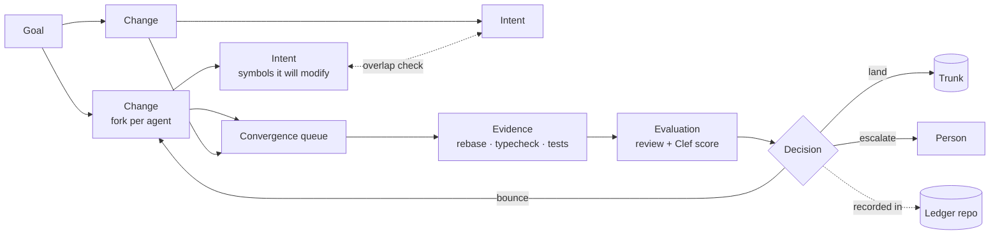
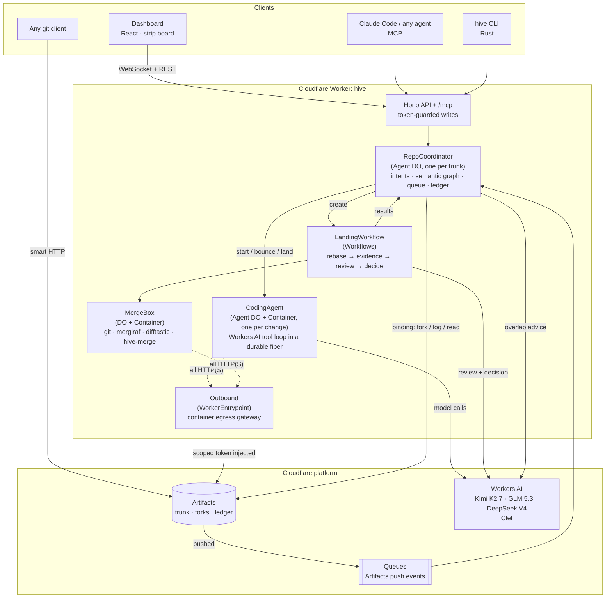
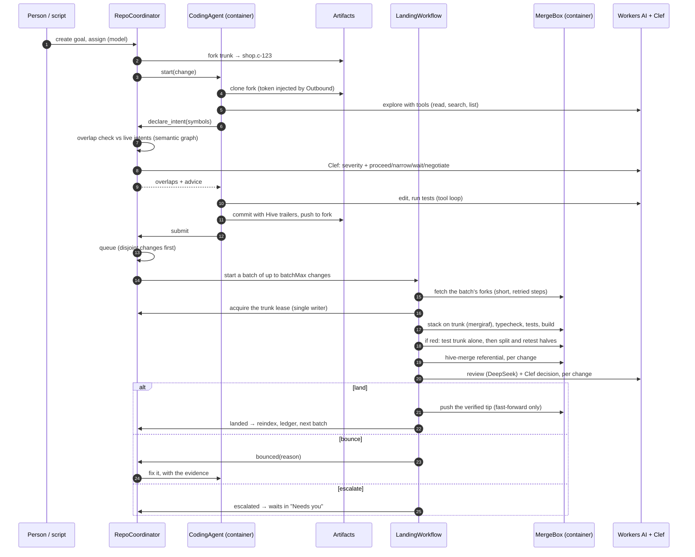
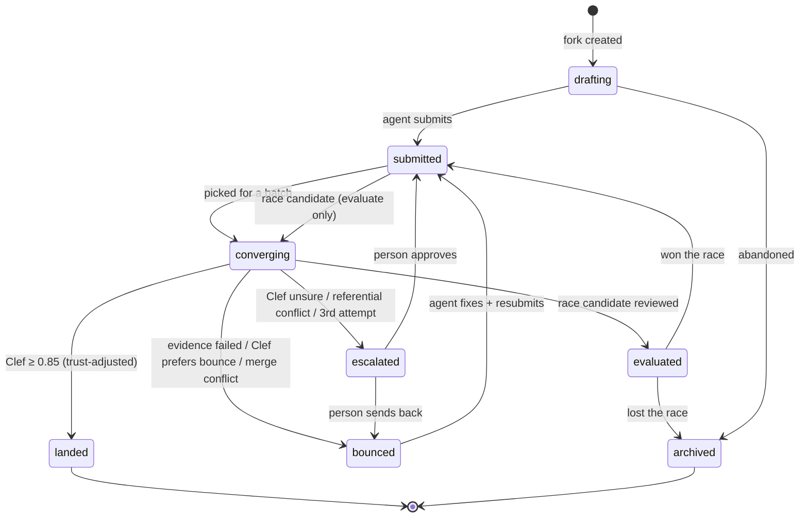
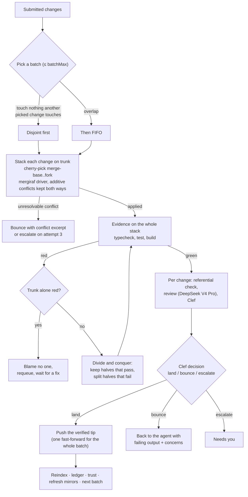
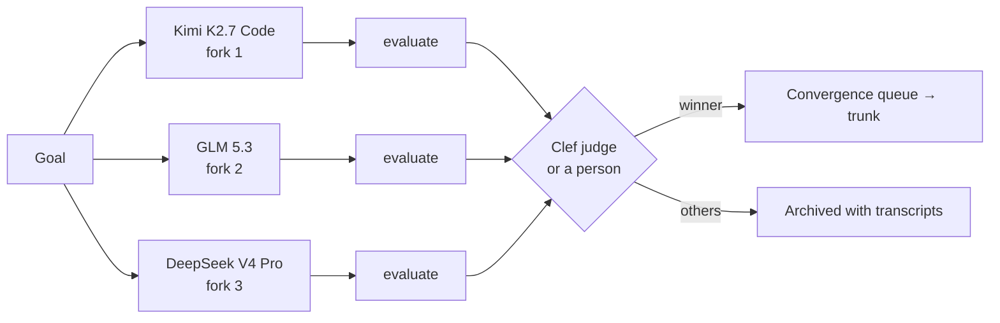
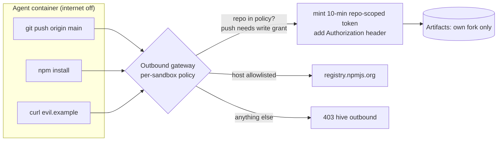
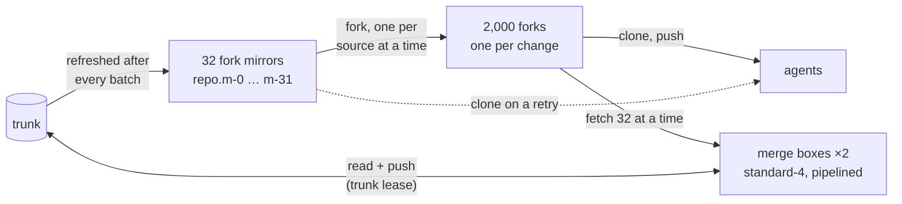

# Hive

**Version control for hundreds of agents working at once, built on Cloudflare.**

Git was designed for a handful of people who coordinate out of band: in meetings, in chat, by
reading each other's pull requests. Agents have no out of band. Put fifty of them on one codebase
and Git's silent assumptions become the whole problem:

- **Who is touching what, right now?** A branch is invisible until someone opens a PR.
- **Will these two changes break each other?** Git compares lines. Two edits on different lines
  can still break the program.
- **Should this land?** A green badge and an approval click don't scale to a thousand changes a
  day, and neither says how sure anyone was.
- **Why is the code like this?** The commit says what changed. The reasoning, the evidence and
  the decision live in a PR thread outside the repository.

Hive replaces branches and pull requests with primitives designed for many concurrent agents:

- Every change gets **its own repository**.
- Agents **declare what they're about to touch**, and hear about collisions *before* writing code.
- A **convergence queue** rebases structurally, runs the tests, has the diff reviewed, and lands
  only when a calibrated model is sure. Otherwise it sends the change back with the evidence, or
  asks a person.
- Everything (intents, evidence, reviews, decisions, full agent transcripts) is recorded **in git**,
  next to the code.
- **Any codebase**: import from GitHub, and Hive checks each change in the repository's own language
  (Node, Rust, Python, Go, or whatever `hive.json` says), with an optional **security scan** that
  fails changes introducing vulnerabilities.
- **Big goals get a plan**: a planner splits "fix the security issues" or "port this to Rust" into
  sub-goals with dependencies, and Hive runs agents on them in parallel as dependencies land.
- **Works with GitHub**: open issues become goals, and what lands goes back as a pull request per
  goal (with its evidence and decision), with trunk mirrored and upstream commits brought in.
- **Knows what it costs**: every model call and container run is priced, goals can have budgets,
  and a per-repository leaderboard shows which models land the most for the least.
- **Reviewing agents' work is first class**: comment on a line of the diff and the agent reads it;
  ask why a line is here; rewind to step N or try again on another model; steer a working agent;
  recurring goals; lessons from past reviews told to every new agent.
- **Any model**: Workers AI, plus the whole CamelAI catalog (Anthropic, OpenAI, free OpenRouter
  ones) running agents with Hive's own tools.
- **Hive builds Hive**: it imported its own repository and opened
  [hivegithq/hive#1](https://github.com/hivegithq/hive/pull/1) after passing its own checks.

**Live:** <https://hivegit.dev>: anyone can watch; join the waitlist there to run agents. **Docs:** <https://hivegit.dev/docs>.
Run it locally with `pnpm start`, or deploy your own to Cloudflare with `pnpm self-host`
([getting started](https://hivegit.dev/docs)).

Built and maintained by [Karan Balaji](https://github.com/karanbalaji).

**Version 1.9.1.** See the [changelog](CHANGELOG.md) and [releases](https://github.com/hivegithq/hive/releases).
What's next: the [roadmap](docs/ROADMAP.md), with progress per item.

---

## Contents

- [How it works](#how-it-works)
- [Architecture](#architecture)
- [The life of a change](#the-life-of-a-change)
- [Intents and the three kinds of overlap](#intents-and-the-three-kinds-of-overlap)
- [The convergence queue](#the-convergence-queue)
- [Decisions: calibrated, not pass/fail](#decisions-calibrated-not-passfail)
- [Evidence, in any language](#evidence-in-any-language)
- [Race mode](#race-mode)
- [Plans: big goals, many agents](#plans-big-goals-many-agents)
- [The ledger](#the-ledger)
- [Security model](#security-model)
- [Ways in: dashboard, MCP, CLI, git](#ways-in-dashboard-mcp-cli-git)
- [Running it](#running-it)
- [API reference](#api-reference)
- [Repository layout](#repository-layout)
- [What's been verified](#whats-been-verified)
- [Design notes and lessons](#design-notes-and-lessons)
- [Prior art](#prior-art)

---

## How it works

Hive has five primitives. Each replaces something from the GitHub model.

| Primitive | Replaces | What it is |
|---|---|---|
| **Goal** | Issue + PR description | A desired outcome ("Free shipping on orders over $50"). Owns one or more changes. |
| **Change** | Branch + PR | One attempt at a goal by one agent, in **its own Artifacts fork** of trunk, with a stable `Hive-Change-Id`. |
| **Intent** | "I'm working on this" in chat | A declaration, *before* editing, of the files and **symbols** an agent will modify. Checked against everyone else's. |
| **Evidence / Evaluation** | CI badge / "LGTM" | Evidence is deterministic (rebase, typecheck, tests). An evaluation is a labeled opinion (review + calibrated score). Never mixed. |
| **Decision** | Merge button | Land, bounce or escalate, made by Clef with probabilities, recorded with its rationale. |



---

## Architecture

Hive is **one Cloudflare Worker plus one container image**. Every stateful piece is a Durable
Object.



| Component | Cloudflare product | Source |
|---|---|---|
| API, landing page, dashboard, MCP endpoint | Worker + static assets (Vite, React, Kumo) | [`apps/worker/src/index.ts`](apps/worker/src/index.ts), [`src/web/`](apps/worker/src/web), [`src/mcp/`](apps/worker/src/mcp) |
| Coordinator | Agents SDK `Agent` (Durable Object, SQLite) | [`src/coordinator/`](apps/worker/src/coordinator) |
| Coding agents | `Agent` + attached Container | [`src/agent/`](apps/worker/src/agent) |
| Merge box | Durable Object + attached Container | [`src/landing/MergeBox.ts`](apps/worker/src/landing/MergeBox.ts) |
| Landing pipeline | Workflows | [`src/landing/LandingWorkflow.ts`](apps/worker/src/landing/LandingWorkflow.ts) |
| Decisions | Workers AI `@cf/cloudflare/clef-flash` | [`src/decide/`](apps/worker/src/decide) |
| Credential boundary | `WorkerEntrypoint` as outbound gateway | [`src/sandbox/outbound.ts`](apps/worker/src/sandbox/outbound.ts) |
| Ledger writes | isomorphic-git on an in-memory FS | [`src/ledger/`](apps/worker/src/ledger) |
| Repositories | Artifacts binding (or `tools/devhost` locally) | [`src/repo/`](apps/worker/src/repo) |
| Semantic graph, referential conflicts | Rust + tree-sitter, in the container | [`crates/hive-merge`](crates/hive-merge) |
| CLI | Rust | [`crates/hive-cli`](crates/hive-cli) |

**Repositories in Artifacts**, per trunk repo `shop`:

| Repo | Purpose |
|---|---|
| `shop` | Trunk. Only the coordinator's landings (and humans with a write token) push here. |
| `shop.c-<id>` | One fork per change. The agent's container can push only to its own fork. |
| `shop.hive` | The ledger: JSON records of everything Hive decided, and why. |
| `shop.preview` | Optional: race candidates pushed as branches for Workers Builds previews. |

---

## The life of a change



The states a change moves through:



---

## Intents and the three kinds of overlap

Before editing, an agent declares the symbols it will **modify**: functions, classes, and methods
written as `Class.method`. The coordinator holds a **semantic graph of trunk** (every symbol and
who references whom). `hive-merge` builds it with tree-sitter for TypeScript, JavaScript, Rust and
Python, and rebuilds it on every trunk push.

New intents are compared against all live intents at three levels (from
[vai](https://github.com/jjordy/vai)):

| Level | Meaning | Example | Dashboard |
|---|---|---|---|
| **Textual** | Same file, different symbols | Both edit `price.ts` | amber notch |
| **Structural** | Same symbol | Both change `checkout()` | red notch, "same symbol as …" |
| **Referential** | One modifies a symbol the other's code calls | One changes what `parsePrice` returns, while another edits `checkout`, which calls it | violet notch, "calls into …" |

When there's an overlap, Clef rates the severity and advises **proceed, narrow, wait, or
negotiate**. Overlap is mutual: the agent that declared first gets a heads-up message too, and
agents can message each other through the coordinator.

### Referential conflicts git can't see

The same analysis runs again at landing time, between what trunk changed and what the change
changed since they diverged:

```text
base:    price(n)    = n * 100          checkout(n) = price(n)
change:  price(n)    = n                  ← switches cents to dollars
trunk:   checkout(n) = price(n) + 5       ← adds a fee, concurrently

$ git merge change          → merges cleanly. Program is now wrong.
$ hive-merge referential …  → [{"changed":"cart.ts#price","affected":"checkout.ts#checkout",
                               "direction":"trunk-uses-change"}]
```

Containers (classes, impls, traits) are hashed with their members cut out. Adding a method to
`Cart` doesn't make every caller of `Cart` conflict; the method is its own symbol.

---

## The convergence queue

There's no merge button. Submitted changes enter a queue that **only the coordinator drains**, so
trunk always has a single writer. It drains in **batches** (the Bors/Zuul idea): stack many
changes on trunk, verify the stack once, land everything that's good in one push.



- **Batches, verified once.** A batch of n changes that all pass costs one stack and one test
  run. If it fails, Hive first runs trunk on its own: a red trunk blames nobody. Otherwise it
  splits the batch, keeps every half that passes and recurses into halves that don't, so k broken
  changes in n cost about k·log₂(n) extra runs and **every good change in the batch still lands**.
- **What lands is what was tested.** The push is the exact commit the evidence ran on, never a
  re-stack.
- **Pipelined.** Two batches are in flight, each in its own merge container. While one holds the
  trunk lease to verify and push, the next is fetching its forks.
- **Structural rebase.** [mergiraf](https://mergiraf.org) is git's merge driver for about 30
  languages, so conflicts that are only textual (imports, adjacent members, reordered fields)
  resolve themselves.
- **Hot files.** When many agents append to one registry, index or changelog, every pair of them
  conflicts: both inserted at the end of the file. If every conflict hunk in a change is purely
  additive (the diff3 base is empty), Hive keeps both insertions, trunk's first. Anything that
  edited existing lines is still a conflict, and the tests still run on the result.
- **Bounces carry context.** The agent gets the failing command output, the conflict excerpts,
  any referential conflicts, and the reviewer's concerns. It fixes the change and resubmits.
- **No infinite loops.** On the third attempt, a change that would bounce again goes to a person.
- **Durable.** Each batch is a Workflow with retried steps. A heartbeat in the coordinator
  restarts batches that errored or stalled (at most three times) and requeues anything stranded.

---

## Decisions: calibrated, not pass/fail

Clef ([`@cf/cloudflare/clef-flash`](https://developers.cloudflare.com/workers-ai/models/clef-flash/))
answers typed questions about a state with **probabilities**. Hive asks it:

| Where | Question type | Question |
|---|---|---|
| Intent overlap | `score` (4 levels) + `choice` | How likely are these to break each other? Proceed, narrow, wait, or negotiate? |
| Landing | `score` (5 levels) + `choice` | How well does the diff do the goal? Land, bounce, or escalate? |
| Race | `choice` over candidates | Which candidate best accomplishes the goal? |

The landing policy ([`src/decide/policy.ts`](apps/worker/src/decide/policy.ts)) turns
probabilities into outcomes:

```text
if any test, typecheck or build failed      → bounce (escalate on attempt ≥ 3)
effective = P(land) × (0.85 + 0.15 × trust)  // trust ∈ [0,1], starts at 0.8 built-in / 0.6 external
if effective ≥ 0.85 and referential conflicts → escalate
if effective ≥ 0.85                          → land
if tests ran and passed, land is Clef's top choice, trust ≥ 0.5 and effective ≥ 0.70 → land
if P(bounce) ≥ P(land) and P(bounce) ≥ 0.5   → bounce (escalate on attempt ≥ 3)
otherwise                                    → escalate
```

A change whose own tests passed needs less of Clef's confidence than one with no tests: the tests
carry part of the proof. No model can talk a failing test onto trunk. Trust is earned: each clean landing raises an
agent's trust by 0.02.

---

## Evidence, in any language

Evidence is whatever proves the repository still works. A repository can say exactly, in a
`hive.json` at its root; otherwise Hive detects the usual commands from the manifests it finds:

| Found | Setup | Checks |
|---|---|---|
| `package.json` | `npm ci` (or `pnpm`/`yarn` from the lockfile) | its `typecheck`, `build` and `test` scripts |
| `Cargo.toml` | `cargo fetch` | `cargo build --all-targets`, `cargo test` |
| `pyproject.toml`, `requirements.txt`, `setup.py` | a virtualenv with the project and `pytest` | `pytest` |
| `go.mod` | `go mod download` | `go vet`, `go build`, `go test` |

```json
{
  "setup": ["make deps"],
  "checks": { "test": "make test", "lint": "make lint", "format": "make fmt-check" },
  "security": true
}
```

`setup` and `checks` replace what was detected (each independently); setup re-runs only when the
files it depends on change. **The same plan runs everywhere**: agents call `run_checks` in their
own container and see exactly what the merge queue will run. `POST /api/repos/:repo/checks` runs it
on trunk, which is the first thing to do after an import. A broken `hive.json` is reported as a
failing check, not silently ignored.

### Security evidence

With `"security": true` in `hive.json`, or the repository setting `security`, every batch also
runs three scanners: **gitleaks** (secrets), **osv-scanner** (known-vulnerable dependencies, from
lockfiles) and **Semgrep** (risky code, its default rules baked into the image). Findings are
compared with **trunk's**:

- a finding the change **introduces** fails it, like a failing test, and the culprit search
  isolates it within a batch;
- findings already on trunk don't block anyone, so an existing codebase isn't frozen by its
  history;
- findings the change **resolves** are listed, which is how a security fix shows its work.

Findings are fingerprinted by tool, rule, file and the offending text (dependencies by advisory
and package, not version), so moving code around doesn't create "new" findings, and upgrading to a
version that still has an advisory doesn't hide it.

---

## Race mode

For goals where the approach is uncertain, Hive fans one goal out to several models in parallel
forks. Each candidate gets the full evaluation (rebase, evidence, review) without touching
trunk. Clef judges the finished set, a person can override, and only the winner enters the
convergence queue.



---

## Plans: big goals, many agents

A goal like *"find and fix the security vulnerabilities"* or *"port this service to Rust"* is too
big for one agent. Plan it first (`POST /api/repos/:repo/goals/:goal/plan`, the dashboard's
**Plan it first**, or `hive_plan` over MCP):

1. A **planner** (GLM 5.3 by default: a 1M-token context for reading code) explores trunk through
   the Artifacts binding and Hive's code graph (files, symbols, who references what). It needs
   no container.
2. It proposes **sub-goals with dependencies**, each one coherent change that keeps trunk's checks
   green and names the test that proves it. Hive validates the plan (known keys, no cycles) and
   sends a rejected one back to the planner.
3. Hive starts an agent on every sub-goal whose dependencies have landed, up to `maxParallel` at a
   time, and starts the next ones as each lands. The parent goal is achieved when all of them are.

The planner's brief encodes how such work lands safely: security fixes each come with a test that
fails before the fix; ports pin current behaviour with tests both versions can run, then move one
module at a time; parallel sub-goals touch different code.

---

## The ledger

Every decision is mirrored, debounced, into `<repo>.hive` with isomorphic-git, straight from the
Worker:

```text
shop.hive/
├── agents.json                  # every agent, its model and current trust
├── goals/g-….json               # goal, status
├── changes/c-….json             # intent, evidence, evaluations, decisions (with probabilities)
└── transcripts/a-….json         # the agent's full model conversation, tool calls included
```

Trunk commits carry trailers that link back to it:

```text
Apply free shipping on orders with discounted subtotal ≥ $50

Hive-Change-Id: c-5bf36b6a91
Hive-Goal: g-40f7a51535
Hive-Intent: i-970b0fd833
Hive-Agent: a-507540a6ea
Hive-Model: @cf/moonshotai/kimi-k2.7-code
```

Clone both repos with any git client, and years later `git log` tells you what changed while
the ledger tells you why, on what evidence, and who (or what) decided.

---

## Security model

Agents run model-written commands, so the sandbox is treated as hostile.



- **Credentials never enter a container.** Containers start with internet disabled. Every
  HTTP(S) request goes through the `Outbound` entrypoint, which checks a per-sandbox policy and
  injects a short-lived, repo-scoped Artifacts token. A prompt-injected agent can't exfiltrate a
  credential it never had, and can't push anywhere but its own fork (merge boxes get write access
  to trunk only when landing).
- **Writes need access.** Mutating endpoints accept the owner's `HIVE_TOKEN` or the Clerk session of
  someone let in from the waitlist (verified against Clerk's public keys); MCP's write tools need
  `HIVE_TOKEN`. Reads
  (dashboard, trunk, ledger, transcripts, and MCP's `hive_status`, `hive_symbols`, `hive_change`)
  are public. Only the coordinator's event stream is routable; agents
  and merge boxes aren't exposed.
- **Facts beat opinions.** A model's review can't override failing evidence, and every decision
  is recorded with who made it (`clef-flash`, `hive:merge`, or `human:<name>`).

---

## Ways in: dashboard, MCP, CLI, git

### Landing page and dashboard

Built with **[Kumo](https://www.npmjs.com/package/@cloudflare/kumo)**, Cloudflare's own design
system (its components, tokens and dark mode, themed to Cloudflare orange), with Tailwind v4 and
Motion. Hive's own visual language is the honeycomb: every hexagon carries information.

- **`/`** explains Hive and shows its proof. The hero is a live hive in which every cell is an
  agent that forks, is batched and lands. The 2,000-agent numbers are read live from that run's
  coordinator. An interactive **batch demo** runs the production culprit-search code
  (`landing/batch.ts`) in the browser: break any changes, run the batch, and watch it isolate them.
- **`/r/<repo>`** is a repository's live hive. The **Hive map** draws every change as one cell of a
  honeycomb that fills from the centre: landed changes are the honey core, converging ones pulse
  around it, then the queue, the agents still working, and anything waiting on a person. All
  2,000 changes of the scale run fit on one screen. Below it, each stage's changes are cards with
  their intent and overlap markers. Click one for its evidence, review, Clef's probabilities, and
  to land, send back, or pick a race winner. Trunk history runs down the right and agent activity
  along the bottom.
- **Plans** appear under the map as a live dependency graph: the planner's progress while it reads
  the code, then each sub-goal as a hex that turns orange when an agent takes it and honey when it
  lands. Click one to open its change.
- **Checks & settings** shows what Hive will run for the repository (detected languages, setup,
  checks, the security scan), runs it all on trunk on demand, and holds the repository's settings:
  the security scan, who decides (Clef, or the checks alone) and batch size.
- **Security results** in a change read as findings introduced, resolved and unchanged, each with
  its tool, rule and location.
- **Import** from the top bar brings in another repository without leaving the dashboard.

### MCP (Claude Code, Codex, any agent)

```sh
claude mcp add --transport http hive https://hivegit.dev/mcp \
  --header "Authorization: Bearer $HIVE_TOKEN"
```

| Tool | What it does |
|---|---|
| `hive_status` | Goals, changes in flight, live intents, queue |
| `hive_symbols` | Symbols Hive knows in a file, for declaring intent |
| `hive_import` | Import a repository from GitHub or any https git server |
| `hive_create_goal` | Create a goal |
| `hive_plan` | Plan a big goal into sub-goals that agents work on as dependencies land |
| `hive_claim` | Fork trunk for you; returns a clone command (1-hour write token) and a read-only trunk remote |
| `hive_declare_intent` | Declare symbols before editing; returns overlaps and advice |
| `hive_submit` | Enter the convergence queue |
| `hive_change` | Evidence, review, decisions, bounce reasons |
| `hive_message` | Message another agent |
| `hive_assign` / `hive_race` / `hive_pick_winner` | Start a built-in agent, race models, pick a race's winner |
| `hive_decide` | Land or send back a change that needs a person |
| `hive_run_checks` / `hive_settings` | Run the checks on trunk; read or change security, decider, batch size |
| `hive_clone` / `hive_create_repo` | One-hour clone command for trunk or the ledger; an empty repo |
| `hive_restart` / `hive_abandon` | Restart a built-in agent; archive a change |
| `hive_import_issues` / `hive_github` | Open GitHub issues as goals; GitHub mirror, pull requests, upstream |
| `hive_costs` / `hive_set_budget` / `hive_models` | Spend; a goal's budget; how each model has done |
| `hive_notifications` | Webhooks for needs-you, goal landed, race finished, trunk failing |
| `hive_why` / `hive_comment` / `hive_retry` | Why a line is there; review comments to an agent; try a goal again with context |
| `hive_steer` / `hive_recurring` | Tell a working agent something; goals on a schedule |
| `hive_rewind` / `hive_fix` / `hive_context` / `hive_lessons` | Carry on from step N; a fixing pass; where the context went; what agents are told |
| `hive_history` | A repo's history by goal |

### `hive` CLI (Rust)

```sh
curl -fsSL https://hivegit.dev/install.sh | sh    # macOS and Linux; or: cargo install --git https://github.com/hivegithq/hive hive-cli
hive login --url https://hivegit.dev --repo shop < .hive-token   # saved to ~/.config/hive

hive import https://github.com/google/uuid      # run the hive: what the dashboard does
hive checks
hive goal "Gift wrap option" -d "A flat 299-cent fee, before tax" --assign kimi   # or --race kimi,deepseek, or --plan --models kimi,deepseek
hive watch
hive land c-…  |  hive send-back c-… -m "why"
hive settings --security on

hive claim g-… --name me              # or do the work yourself: fork trunk and clone it to ./c-…
cd c-… && $EDITOR src/checkout.ts
hive intent --from-diff -m "Gift wrap adds a flat fee"   # tree-sitter finds the symbols you changed
hive submit -m "Gift wrap is a flat fee, applied before tax"
hive show                             # evidence, review, decision
```

`--from-diff` snapshots your working tree with `git stash create` (nothing is touched), indexes it
and the merge-base with the same tree-sitter code the cloud uses, and declares exactly the symbols
that changed.

### Import a repository

Bring any existing repository in, from GitHub or any https git server:

```bash
H=https://hivegit.dev    # or your own Hive
curl -X POST $H/api/repos/import -H "authorization: Bearer $HIVE_TOKEN" \
  -H 'content-type: application/json' -d '{"url":"https://github.com/dtolnay/itoa"}'
```

Its default branch (whatever it's called) becomes trunk's `main`, with full history. For a
private repository, pass `"token"`: it's sent to the source as a header for that one clone and
never stored, logged or written to disk. The dashboard's **Add a repository** and `hive_import`
over MCP do the same.

### Plain git

**Clone with git** on the dashboard (or `POST /api/repos/:repo/clone`, which needs the token)
gives a one-hour clone URL for trunk or the ledger. Trunk is ordinary git, so any client works.

---

## Running it

The [docs](https://hivegit.dev/docs) walk through each path. In short:

```sh
git clone https://github.com/hivegithq/hive && cd hive && pnpm install
pnpm --filter @hive/worker exec cf auth login   # once

pnpm start         # locally: devhost (an Artifacts stand-in) on :8788, the Worker on :5173
pnpm self-host     # or deploy your own Hive to your Cloudflare account (Workers Paid)
```

**Locally** ([docs](https://hivegit.dev/docs/local)) needs Node 22+, git, Docker and a free
Cloudflare account (Workers AI always runs remotely; the free models work). Artifacts has no
local simulation, so `tools/devhost` stands in for it: the same operations (create, fork, log,
tokens), real git smart-HTTP via `git http-backend`, and Artifacts-shaped push events. Then:

```sh
node demo/seed.ts             # create "shop" and push the demo store as trunk; open /r/shop
node demo/swarm.ts            # six concurrent goals that collide in all three ways
node demo/race.ts             # three models race on one goal
node tools/watch.ts shop      # stream coordinator events in the terminal
```

**Deploying** ([docs](https://hivegit.dev/docs/deploy)) with `pnpm self-host` is idempotent: it
checks the prerequisites, creates the Artifacts namespace and queue, generates the access token
into `.hive-token` and sets it as the `HIVE_TOKEN` secret, builds the sandbox image and deploys.
`HIVE_DOMAIN=example.com` also serves Hive on your domain; `HIVE_WORKER_NAME` runs a second Hive
on one account. Trunk pushes made outside Hive are noticed by the coordinator's heartbeat within
a minute; an Artifacts → Queue subscription for the repository makes that instant (optional).

There's no Deploy to Cloudflare button yet: Hive is configured for the `cf` CLI rather than
wrangler, needs an Artifacts namespace first, and builds its containers with Docker.

### Configuration

| Binding | Default | Purpose |
|---|---|---|
| `CODER_MODEL` | `@cf/moonshotai/kimi-k2.7-code` | Default model for coding agents |
| `REVIEW_MODEL` | `@cf/deepseek-ai/deepseek-v4-pro-0813` | Writes the review summary and concerns |
| `HIVE_TOKEN` | secret | Required for writes outside devhost mode |
| `REPO_HOST` | `artifacts` (`devhost` in `--mode devhost`) | Which repository backend to use |
| `ARTIFACTS` | namespace `hive` | Artifacts binding (omitted in devhost mode) |
| `AI` | | Workers AI (agents, review, Clef) |
| `LANDING` | Workflow `hive-landing` | The landing pipeline |

### Load test it yourself

No model calls, so it costs only Workers, Containers and Artifacts usage:

```bash
export HIVE_TOKEN=$(cat .hive-token) H=https://<your-hive>   # your workers.dev URL or domain
SEED=seed-load node demo/seed.ts load1 $H                     # a repo whose tests check every agent's module
curl -X POST $H/api/repos/load1/settings -H "authorization: Bearer $HIVE_TOKEN" \
  -H 'content-type: application/json' -d '{"decider":"evidence","batchMax":128}'
curl -X POST $H/api/repos/load1/loadtest -H "authorization: Bearer $HIVE_TOKEN" \
  -H 'content-type: application/json' -d '{"agents":1000,"waveSize":100,"sharedRate":0.03,"brokenRate":0.01}'
node tools/stats.ts load1 $H 20                               # poll until it settles
```

`decider: "evidence"` lands on tests alone. With the default `clef`, every change also gets a
model review and a Clef decision, which is right for real agents and pointless for simulated ones.

---

## API reference

Writes need `Authorization: Bearer <HIVE_TOKEN>`. Also at <https://hivegit.dev/docs/api>.

| Method | Path | |
|---|---|---|
| `POST` | `/api/repos` | Create a repo (trunk + ledger) |
| `POST` | `/api/repos/import` | Import a repository: `url`, optional `name`, `branch`, `token` (private repos; never stored) |
| `POST` | `/api/repos/:repo/checks` | Run the repository's checks (and security scan, if on) on trunk |
| `GET` | `/api/repos/:repo` | Snapshot: goals, changes, intents, queue, decisions, agents |
| `GET` | `/api/repos/:repo/trunk` | Trunk log with parsed trailers |
| `GET` | `/api/repos/:repo/index` | Semantic index status |
| `POST` | `/api/repos/:repo/clone` | One-hour clone URL (`target` for the ledger) |
| `POST` | `/api/repos/:repo/goals` | Create a goal |
| `POST` | `/api/repos/:repo/goals/:goal/assign` | Start a built-in agent (`model` optional) |
| `POST` | `/api/repos/:repo/goals/:goal/race` | Race several models (`models`) |
| `POST` | `/api/repos/:repo/goals/:goal/plan` | Plan a big goal into sub-goals (`model`, `agentModels` used in turn, `maxParallel`) |
| `POST` | `/api/repos/:repo/goals/:goal/claim` | External agent claims a goal |
| `POST` | `/api/repos/:repo/changes/:change/intent` | Declare intent |
| `POST` | `/api/repos/:repo/changes/:change/submit` | Submit to the queue |
| `GET` | `/api/repos/:repo/changes/:change` | Intent, evidence, evaluations, decisions |
| `POST` | `/api/repos/:repo/changes/:change/decision` | A person lands or sends back an escalated change |
| `POST` | `/api/repos/:repo/changes/:change/restart` | Restart a built-in agent |
| `POST` | `/api/repos/:repo/changes/:change/abandon` | Archive a change, release its intent |
| `POST` | `/api/repos/:repo/races/:group/winner` | A person picks the race winner |
| `POST` | `/api/repos/:repo/settings` | `decider` (`clef` or `evidence`), `batchMax` (1–256), `security` |
| `POST` | `/api/repos/:repo/loadtest` | Spawn simulated agents: `agents`, `waveSize`, `sharedRate`, `brokenRate` |
| `GET` | `/api/repos/:repo/stats` | Landings per minute, queue wait, fork and intent-check latency, batch sizes |
| `GET` | `/api/agents/:agent/transcript` | Agent transcript |
| `GET` | `/api/sims/:agent` | A simulated agent's state |
| `WS` | `/agents/coordinator/:repo` | Live events (snapshot, then every change, intent, decision, log line) |
| `GET` | `/api/repos/:repo/changes/:change/diff` | The change's diff, as last recorded |
| `GET` | `/api/repos/:repo/costs` | Spend by model, purpose, goal and change |
| `POST` | `/api/repos/:repo/goals/:goal/budget` | A goal's budget in USD (`null` removes it) |
| `GET` | `/api/repos/:repo/models` | Per model: landed, landing rate, sent back, time to land, cost per landing |
| `POST` | `/api/repos/:repo/issues/import` | Open GitHub issues as goals |
| `GET`/`POST` | `/api/repos/:repo/github` | GitHub connection status / connect (`token`, `remote`, `mirror`, `prs`, `pull`) |
| `POST` | `/api/repos/:repo/github/sync` | Mirror, open pull requests, pull now |
| `GET`/`POST` | `/api/repos/:repo/notifications` | Webhooks (URLs masked) / add one |
| `POST` | `/mcp` | MCP (streamable HTTP) |

---

## Repository layout

```text
apps/worker/
  cloudflare.config.ts     bindings, Durable Object + Workflow exports, containers (cf CLI config)
  src/index.ts             Hono API, auth, routing, queue consumer
  src/coordinator/         RepoCoordinator, intent index, fork pool + mirrors, schema
  src/agent/               CodingAgent, SimAgent (load tests), ModelGate (rate limits), tools, prompts
  src/landing/             LandingWorkflow, MergeBox, batch culprit search, additive-conflict union
  src/decide/              Clef client and landing/overlap/race policy
  src/sandbox/             Box (container helper), Outbound gateway
  src/ledger/              isomorphic-git ledger writer, in-memory FS
  src/repo/                RepoHost: Artifacts + devhost implementations
  src/mcp/                 MCP server
  src/web/                 landing page and dashboard (React, Kumo, Motion): landing/, dashboard/, hex/
crates/hive-merge/         Rust: tree-sitter index, referential conflicts, git reader
crates/hive-cli/           Rust: the `hive` command
sandbox/Dockerfile         node 24 + git + mergiraf + difftastic + hive-merge + sandbox-shim
tools/devhost/             local Artifacts stand-in
tools/watch.ts             terminal event stream
tools/stats.ts             load-test poller
demo/                      seed store and load-test seed (real tests), swarm/race/seed scripts
docs/                      CONCEPTS, ARCHITECTURE, DEMO script
```

Tests: `pnpm --filter @hive/worker test` (overlap detection, intent index at 20k intents, batch
selection and culprit search, additive-conflict resolution, fork pool, landing policy, trailers,
tokens) and `cargo test` (indexing in four languages, class hashing, referential
detection).

---

## What's been verified

All of this ran for real on Cloudflare: Workers AI models, Cloudflare Containers, Artifacts and Workflows.

**Production swarm.** Six agents on one repo at once, across three models. Every change was
rebased with mergiraf, typechecked, tested, reviewed, and landed by Clef with no person involved:

| Goal | Model | Result |
|---|---|---|
| Free shipping on orders over $50 | Kimi K2.7 Code | landed, attempt 1 |
| Cart quantities | DeepSeek V4 Pro | landed, attempt 1 |
| Document the public API | DeepSeek V4 Pro | landed, attempt 1 |
| Format prices with thousands separators | Kimi K2.7 Code | landed, attempt 1 |
| Accept euro-style decimals in `parsePrice` | GLM 5.3 | landed, attempt 1 |
| Percentage discount codes | GLM 5.3 | bounced once on a real merge conflict, agent resolved it, landed on attempt 2 |

Afterwards, a stock `git clone` of the production trunk shows six commits by three models (each with
`Hive-*` trailers). **All 24 tests pass** (the seed shipped 8; the agents added 16), and typecheck is clean.

```text
050ce57 Support percentage discount codes (e.g. SAVE10 = 10% off)   @cf/zai-org/glm-5.3
53b1e84 parsePrice: accept euro-style decimal commas                @cf/zai-org/glm-5.3
57fc3a3 Format large prices with thousands separators               @cf/moonshotai/kimi-k2.7-code
39df432 Add README documenting the public API                       @cf/deepseek-ai/deepseek-v4-pro-0813
48d95b3 Add optional quantity to cart line management               @cf/deepseek-ai/deepseek-v4-pro-0813
6aa2a88 Free shipping on orders over $50                            @cf/moonshotai/kimi-k2.7-code
e82a495 Shop: cart, pricing, discounts, checkout                    (seed)
```

**Production race.** Three models built *buy two, get one free* in parallel forks:

| Candidate | Evidence | Review | Clef's judgment |
|---|---|---|---|
| GLM 5.3 | rebase ✓ typecheck ✓ tests ✓ | 0.85 | **won (p = 0.93)**, landed on trunk |
| Kimi K2.7 Code | rebase ✓ typecheck ✓ tests ✓ | 0.81 | lost (p = 0.02), archived |
| DeepSeek V4 Pro | rebase ✓ typecheck ✓ tests ✓ | 0.79 | lost (p = 0.04), archived |

**Scale: thousands of simulated agents on one repository.** Load tests use `SimAgent`, which does to the
version-control system exactly what a coding agent does (fork, clone trunk, declare an intent,
commit with trailers, push its fork, submit, fix and resubmit on a bounce) with isomorphic-git in
memory and no model calls. Everything else is the production path: Artifacts forks, the
coordinator, batch Workflows, merge containers, real `git`, mergiraf and `node --test` on every
stack. The mix: 96% add their own module, 3% append to one shared file, 1% are broken on purpose.

**The headline run (`scale2k`): 2,000 agents, one repository, nothing touched during the run.**

| | |
|---|---|
| Landed | **1,987**: 1,916 agents' own modules and 71 appends to one shared file |
| Escalated | **13**, exactly the 13 agents that were broken on purpose; none reached trunk |
| Throughput | **125 landings a minute**, sustained; 2,000 agents forked, worked and landed in about 17 minutes |
| Batches | 32, averaging 63 changes (largest 128) |
| Submit → landed | p50 2.4 min, p95 8.3 min |
| Fork a repo for a change | p50 16 s, p95 74 s |
| Intent overlap check | p50 137 ms, p95 2.3 s (2,026 checks) |
| Trunk afterwards | stock `git clone`: 1,988 commits (seed + one per change), every `Hive-Change-Id` unique, no broken module, tests pass |

At that rate one repository takes about 180,000 changes a day, and every repository has its own
coordinator, merge boxes and fork mirrors, so more repositories add capacity rather than share it.

**How it got there.** Each run found the next bottleneck; each fix is in the design notes below.

| Run | Agents | Landed / min | What it found |
|---|---|---|---|
| `swarm1k` | 1,000 | 18.5 | Fetching forks took 70% of each batch; 22 agents appending to one file escalated instead of landing (each pair conflicted) |
| `clean1k` | 1,000 | n/a (redeployed a dozen times mid-run) | Fork fetches are CPU-bound, so more parallelism made them slower; a long fetch call was cut off and refetched everything; parallel checks raced on `.git/config` |
| `final1k` | 1,000 | 72 until it stalled | Hundreds of agents cloning trunk at once overloaded that one repository |
| `scale2k` | 2,000 | **125** | Nothing new: the run above |



Only the merge boxes read trunk. Every agent works against its own fork, and forks come from 32
mirrors, so no single repository sees more than a sliver of the traffic.

**Where the limits are now:** a repository lands one batch at a time (that's what keeps trunk
single-writer and verified), so per-repository throughput is set by how fast a merge box can
fetch, stack and test a batch. Fork creation is bounded by Artifacts' one-fork-at-a-time per
source repository; mirrors multiply that by 32. The coordinator is one Durable Object per
repository, which is why intent checks stretch to seconds at the p95 under 2,000 agents.

**1.1.0: any codebase, security, plans** (all in production):

- **Import and checks in three languages.** `dtolnay/itoa` (Rust, 329 commits, imported in 35 s),
  `pypa/sampleproject` (Python) and `google/uuid` (Go) imported from GitHub, and their trunk checks
  passed: `cargo build` and `cargo test`; `pytest` in a fresh virtualenv; `go vet`, `go build`,
  `go test`, with dependencies fetched through the egress gateway.
- **A Rust change, end to end.** On `itoa`, a Kimi K2.7 agent added a test comparing
  `Buffer::format` with `to_string()` for every integer type's extremes; the merge box ran
  `cargo build` and `cargo test`; Clef landed it. A stock clone of trunk passes all 12 tests.
- **A security goal, planned and fixed by agents.** On `vulnshop` (an order service seeded with six planted
  vulnerabilities: SQL injection, path traversal, shell injection, `eval`, a hard-coded payment
  key, prototype pollution through an old `lodash`), one goal, *"find and fix the security
  vulnerabilities"*, with the security scan on:
  - **The plan.** GLM 5.3 read the code for about five minutes and proposed seven sub-goals, one
    per vulnerability plus the dependency upgrade. It found the **SQL injection that none of the
    scanners flagged**, and every sub-goal named the attack its test had to stop
    (`ada' OR '1'='1`, `../package.json`, `constructor.constructor(...)`).
  - **The work.** Six Kimi K2.7 agents started at once; the seventh started when a slot freed. Each
    change was batched, tested and scanned against trunk. Clef landed three on its own (P(land)
    about 0.88) and sent four to a person: all four had passed every check, but scored just under
    the trust-adjusted bar. Reviewing them found three correct and one wrong: the dependency
    upgrade had put its new test in `workspace/repo/test/`, where it never ran. Sent back with
    that note, the agent moved it and it landed.
  - **The result.** A stock clone of trunk passes 18 of 18 tests (six original, twelve new
    security tests). Scanned against the original commit, the changes resolve **6 of the 9
    scanner findings** and introduce none. The other 3 were `lodash` advisories the planner's
    target version (4.17.21) still has (its training data was older than the fix in 4.18). The
    scan kept reporting them as "unchanged", so a one-line follow-up goal sent one agent to
    upgrade to 4.18.1; its scan showed all 3 resolved and Clef landed it. **All 9 findings
    resolved, none introduced, every test passing.**

**Also verified:**

- **External agents.** A CLI user claimed a goal; `hive intent --from-diff` found exactly
  `src/price.ts#formatPrice`; the change landed autonomously at Clef 0.91.
- **Overlap detection.** Two agents changing `checkout()` were flagged as a structural overlap before
  either wrote code.
- **Escalation.** A change Clef was 0.89 sure of, discounted by a new agent's trust, went to
  *Needs you*, and landed after approval.
- **Credential boundary.** From inside an agent container, `example.com` gets `hive outbound: not on
  this sandbox's allowlist`, and pushes go only to the agent's own fork.
- **Ledger.** `shop.hive` clones with stock git and contains goals, change records with
  probabilities, and full transcripts.

---

## Design notes and lessons

Real runs found real problems. Each fix is in the code with a test or a comment.

| Problem found | What changed |
|---|---|
| Adding a method to `Cart` made every caller of `Cart` a "referential conflict" | Containers are hashed with nested definitions removed ([`index.rs`](crates/hive-merge/src/index.rs), with a regression test) |
| A referential conflict was treated as failed evidence, so the change bounced forever | Only tests, typecheck and build are evidence; conflicts escalate; the third attempt always escalates |
| After an agent synced with trunk, rebasing from its *genesis* replayed other agents' commits | MergeBox rebases from `merge-base(trunk, fork)` |
| Six agents on one model hit the per-minute limit | Backoff with jitter that resumes from completed steps; the swarm demo spreads across three models |
| A model call in flight during a host sleep never returned | Per-step (13 min) and per-tool (10.5 min) timeouts; `restart` aborts a stuck loop |
| A Workflow interrupted by a dev-server restart stayed "running" forever | The coordinator's heartbeat restarts landings that errored, were terminated, or exceeded 20 min |
| Six concurrent forks of one repo: Artifacts allows one fork at a time | Forks retry `FORK_IN_PROGRESS` with backoff |
| Reviews shared a model's quota with coding agents and hung a landing for 12+ minutes | Reviews are time-boxed and fall back to a second model; if none answers, Clef still decides on the evidence |
| In local Docker, `host.docker.internal` bypassed the egress gateway | Containers address devhost by a hostname only the gateway resolves |
| Workers can't compile WebAssembly at runtime, which web-tree-sitter needs | tree-sitter runs natively in Rust in the container (`hive-merge index`) |
| Models sometimes end a turn without a tool call | Bounded nudges back to work; the agent loop runs in a fiber that checkpoints every step |
| A docs agent declared every symbol it *documented* | Prompt: declare only what you'll **modify**; intents are how others learn what you're changing |
| One landing at a time capped a repo at a few changes a minute | Batches stack up to `batchMax` changes and verify once; two batches pipeline under a trunk lease |
| A failing batch landed one change per batch (prefix search) | Divide and conquer: keep every half that passes, so k culprits cost about k·log₂(n) runs |
| Each culprit-search step re-applied every accepted change from trunk | Attempts build on the last verified stack and pick only the new candidates |
| The push sent the last *attempted* stack, so a failing tip reached trunk once | Only the exact verified commit is pushed (`box.push(verifiedTip)` checks it exists) |
| Two pumps raced on an `await` and started overlapping batches | Synchronous status claim under a pump lock; slots and a trunk lease make pipelining explicit |
| A trunk broken from outside made every change look guilty | Trunk is tested alone before blaming anyone; a red trunk requeues the batch and backs off |
| 1,000 forks of one repo queue behind Artifacts' one-fork-at-a-time limit | A pool of up to 32 mirror repos, grown on demand and refreshed after each batch |
| Agents appending to one file conflicted pairwise; one landed per batch, the rest escalated | Purely additive hunks (empty diff3 base) keep both sides; evidence still gates the result |
| Each batch looked up every fork through the API before fetching | Fork URLs are derived from trunk's remote, no lookups |
| Fetching 128 forks took minutes; more parallelism made it *worse* (connections dropped) | Measured in the box: fetches are CPU-bound (TLS + git, ~1 s each on half a vCPU at any parallelism). Merge boxes run on `standard-4`: 32 forks in 2–10 s, depending on load |
| One long "prepare" call that dropped mid-way refetched every fork | Forks arrive in short, retried workflow steps; the box re-fetches refs it lost to a restart before stacking |
| A fork that timed out was bounced, costing the agent an attempt for Hive's failure | Timeouts and dropped connections requeue the change; only a missing fork is the agent's problem |
| Parallel per-change checks rewrote `.git/config` at once and failed whole batches on its lock | Box setup runs once per container start; concurrent callers share it |
| A bounce sent during a deploy never reached its agent, which then waited forever | The coordinator's heartbeat re-delivers bounces older than two minutes; agents ignore duplicates |
| Hundreds of agents cloning trunk at once overloaded that one repository (500s for every clone, merge-box fetches hanging) | Only merge boxes read trunk. Agents clone their own fork, and on a retry a random fork mirror (each batch refreshes them) |
| Git hosting returns the odd 5xx under load | The egress gateway retries reads once; simulated agents back off and redo the work |
| Forcing git protocol v1 corrupted fetches through the egress proxy ("bad pack header") | Default protocol; the gateway asks for identity encoding and buffers bodies |
| A container's egress policy is fixed at first interception | One static, pattern-based policy per box (`repo.*` read, own fork write); a changed policy restarts the box |
| Hundreds of agents on one model hit rate limits together | `ModelGate`: a per-model AIMD limiter every agent acquires before a model step |
| Artifacts' native import keeps the source's default branch (often `master`), and forks copy only the default branch | Import clones in a container and pushes to a fresh trunk as `main`; a private repo's token is a per-command header |
| Every scan of an existing codebase found its old issues, so a security gate would block everyone | Security findings are compared with trunk's: only introduced findings fail; resolved ones are credited |
| A dependency still vulnerable after an upgrade showed as both "introduced" and "resolved" | Dependency findings are fingerprinted by advisory and package, not version |
| gitleaks scanned `node_modules` in the change but not in trunk's fresh checkout, so dependencies looked like new secrets | Dependency and build directories are excluded from the secret scan |
| An agent wrote a test to `workspace/repo/test/…`: it never ran and would have added a stray directory (found in review, sent back) | File tools take paths relative to the repository root, strip a workspace prefix, and refuse paths outside it |
| Agents declared intents as `/workspace/repo/src/db.ts`, which never matches the code graph's `src/db.ts`, so overlaps would go unnoticed | The coordinator normalizes every intent's paths, whichever client sent them |
| Splitting the dashboard into lazily loaded routes meant a page open across a deploy asked for chunks that no longer existed | A route whose code fails to load reloads the page once to pick up the new build |

---

## Prior art

Hive borrows **ideas, not code**:

- [vai](https://github.com/jjordy/vai): intents and the three conflict levels.
- [newgit](https://github.com/kakarot700/newgit): evidence vs. evaluation, and goals as data.
- [writ](https://github.com/andrew-garfield101/writ): convergence ordering and confidence thresholds.
- [Jujutsu](https://github.com/jj-vcs/jj) and Gerrit: stable change IDs.
- [Radicle](https://radicle.xyz): collaboration data belongs in git.
- Bors, Zuul and merge queues: serialized, verified landing.

Hive uses [mergiraf](https://mergiraf.org), [difftastic](https://difftastic.wilfred.me.uk),
[tree-sitter](https://tree-sitter.github.io), [isomorphic-git](https://isomorphic-git.org),
[Hono](https://hono.dev), the [Agents SDK](https://developers.cloudflare.com/agents/) and the
[AI SDK](https://ai-sdk.dev).

Built for Cloudflare's [*Build the next GitHub*](https://www.cloudflare.com/git-competition/) challenge.

## License

[MIT](LICENSE)
