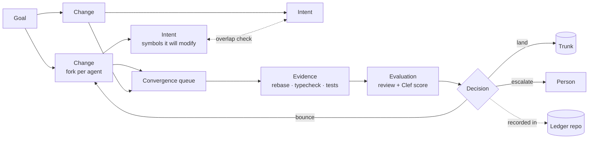
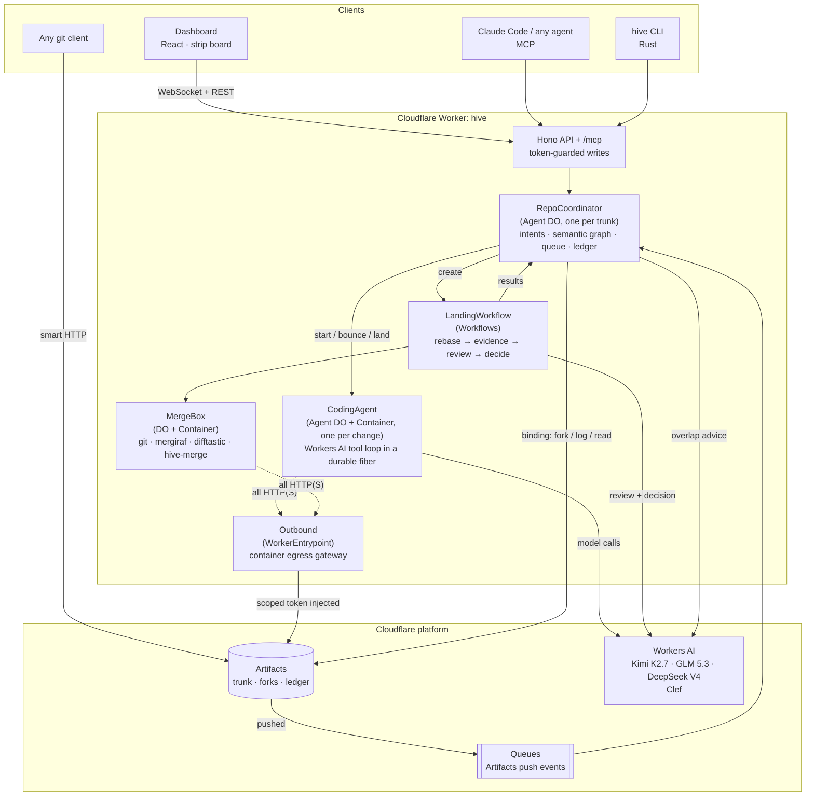
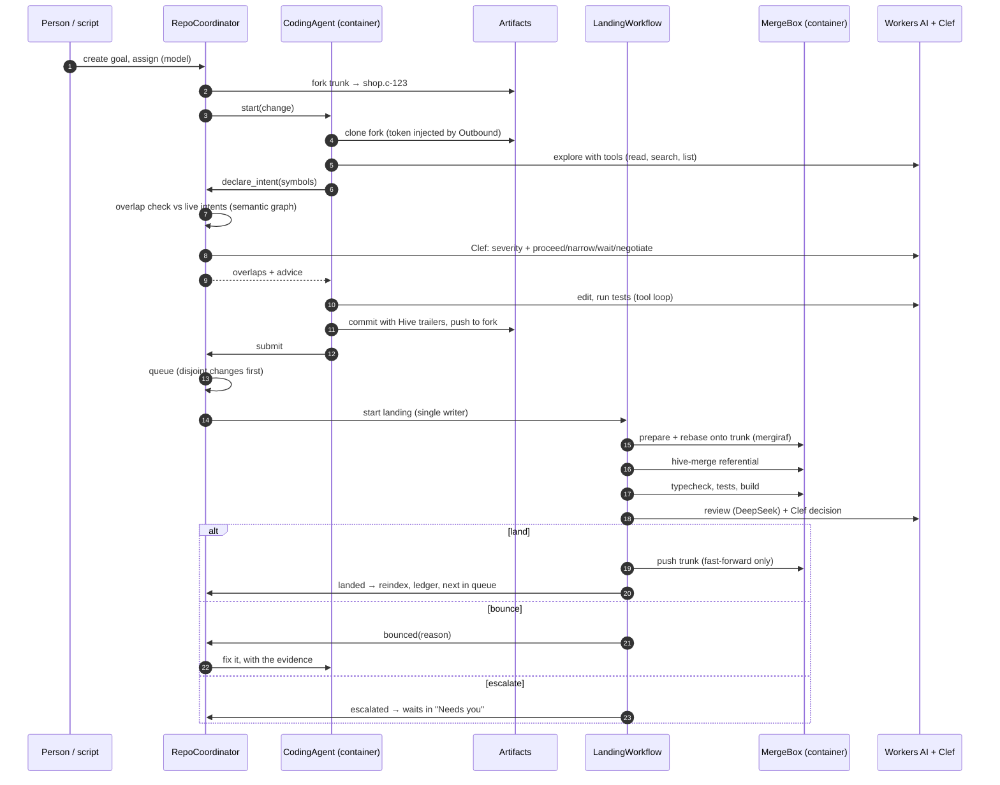
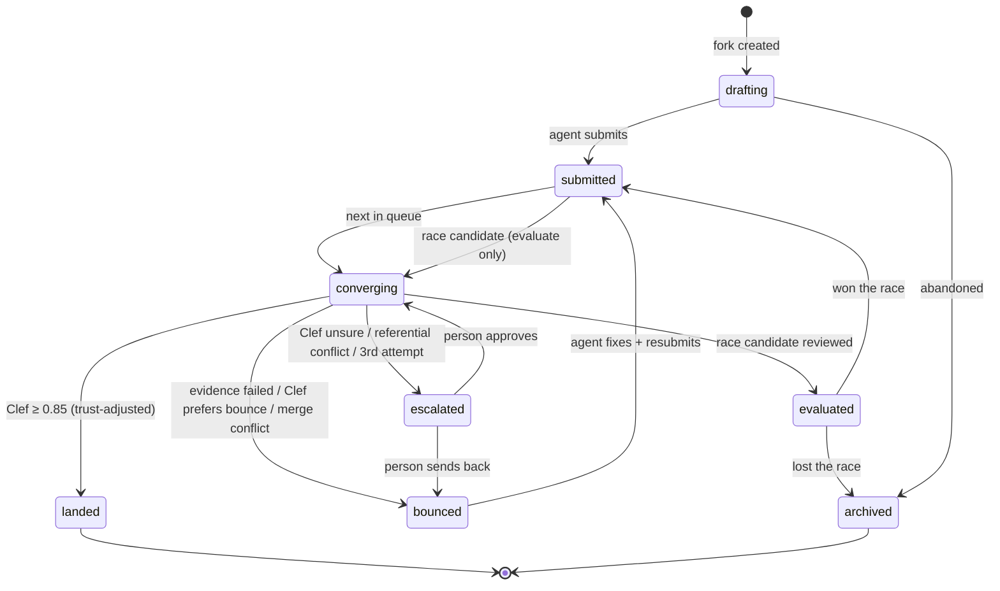
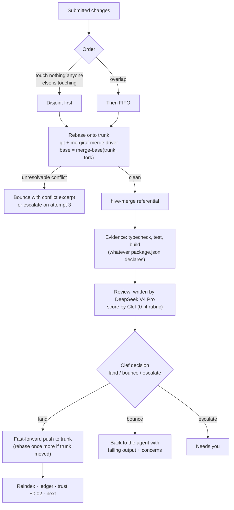
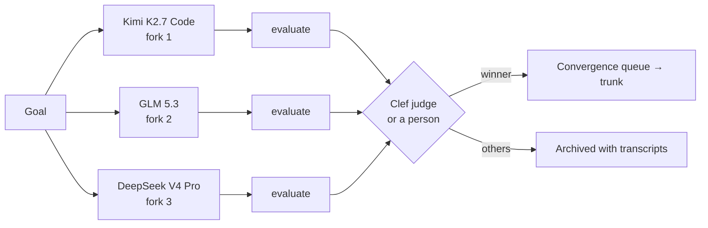
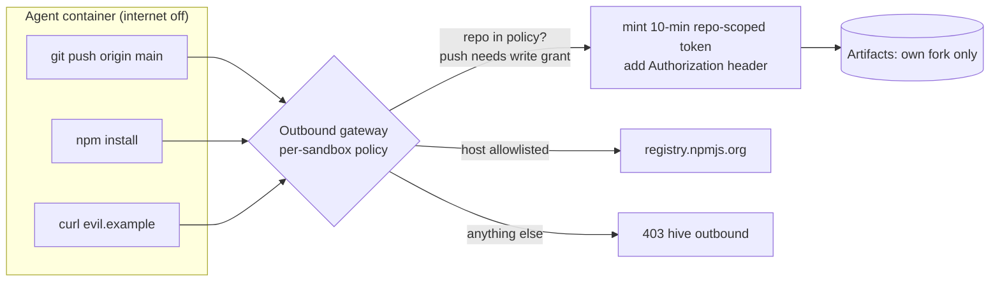

# Hive

**Version control for hundreds of agents working at once, built on Cloudflare.**

Git was designed for a handful of people who coordinate out of band: in meetings, in chat, by
reading each other's pull requests. Agents have no out of band. Put fifty of them on one codebase
and Git's silent assumptions become the whole problem:

- **Who is touching what, right now?** A branch is invisible until someone opens a PR.
- **Will these two changes break each other?** Git compares lines. Two edits on different lines
  can still break the program.
- **Should this land?** A green badge and an approval click don't scale to a thousand changes a
  day, and neither says how sure anyone was.
- **Why is the code like this?** The commit says what changed. The reasoning, the evidence and
  the decision live in a PR thread outside the repository.

Hive replaces branches and pull requests with primitives designed for many concurrent agents:

- Every change gets **its own repository**.
- Agents **declare what they're about to touch**, and hear about collisions *before* writing code.
- A **convergence queue** rebases structurally, runs the tests, has the diff reviewed, and lands
  only when a calibrated model is sure. Otherwise it sends the change back with the evidence, or
  asks a person.
- Everything (intents, evidence, reviews, decisions, full agent transcripts) is recorded **in git**,
  next to the code.

**Live:** <https://hive.kabadigitalinc.workers.dev>. Reads are public; changes need the
deployment's access token.

---

## Contents

- [How it works](#how-it-works)
- [Architecture](#architecture)
- [The life of a change](#the-life-of-a-change)
- [Intents and the three kinds of overlap](#intents-and-the-three-kinds-of-overlap)
- [The convergence queue](#the-convergence-queue)
- [Decisions: calibrated, not pass/fail](#decisions-calibrated-not-passfail)
- [Race mode](#race-mode)
- [The ledger](#the-ledger)
- [Security model](#security-model)
- [Ways in: dashboard, MCP, CLI, git](#ways-in-dashboard-mcp-cli-git)
- [Running it](#running-it)
- [API reference](#api-reference)
- [Repository layout](#repository-layout)
- [What's been verified](#whats-been-verified)
- [Design notes and lessons](#design-notes-and-lessons)
- [Prior art](#prior-art)

---

## How it works

Hive has five primitives. Each replaces something from the GitHub model.

| Primitive | Replaces | What it is |
|---|---|---|
| **Goal** | Issue + PR description | A desired outcome ("Free shipping on orders over $50"). Owns one or more changes. |
| **Change** | Branch + PR | One attempt at a goal by one agent, in **its own Artifacts fork** of trunk, with a stable `Hive-Change-Id`. |
| **Intent** | "I'm working on this" in chat | A declaration, *before* editing, of the files and **symbols** an agent will modify. Checked against everyone else's. |
| **Evidence / Evaluation** | CI badge / "LGTM" | Evidence is deterministic (rebase, typecheck, tests). An evaluation is a labeled opinion (review + calibrated score). Never mixed. |
| **Decision** | Merge button | Land, bounce or escalate, made by Clef with probabilities, recorded with its rationale. |



---

## Architecture

Hive is **one Cloudflare Worker plus one container image**. Every stateful piece is a Durable
Object.



| Component | Cloudflare product | Source |
|---|---|---|
| API, dashboard, MCP endpoint | Worker + static assets (Vite, React) | [`apps/worker/src/index.ts`](apps/worker/src/index.ts), [`src/web/`](apps/worker/src/web), [`src/mcp/`](apps/worker/src/mcp) |
| Coordinator | Agents SDK `Agent` (Durable Object, SQLite) | [`src/coordinator/`](apps/worker/src/coordinator) |
| Coding agents | `Agent` + attached Container | [`src/agent/`](apps/worker/src/agent) |
| Merge box | Durable Object + attached Container | [`src/landing/MergeBox.ts`](apps/worker/src/landing/MergeBox.ts) |
| Landing pipeline | Workflows | [`src/landing/LandingWorkflow.ts`](apps/worker/src/landing/LandingWorkflow.ts) |
| Decisions | Workers AI `@cf/cloudflare/clef-flash` | [`src/decide/`](apps/worker/src/decide) |
| Credential boundary | `WorkerEntrypoint` as outbound gateway | [`src/sandbox/outbound.ts`](apps/worker/src/sandbox/outbound.ts) |
| Ledger writes | isomorphic-git on an in-memory FS | [`src/ledger/`](apps/worker/src/ledger) |
| Repositories | Artifacts binding (or `tools/devhost` locally) | [`src/repo/`](apps/worker/src/repo) |
| Semantic graph, referential conflicts | Rust + tree-sitter, in the container | [`crates/hive-merge`](crates/hive-merge) |
| CLI | Rust | [`crates/hive-cli`](crates/hive-cli) |

**Repositories in Artifacts**, per trunk repo `shop`:

| Repo | Purpose |
|---|---|
| `shop` | Trunk. Only the coordinator's landings (and humans with a write token) push here. |
| `shop.c-<id>` | One fork per change. The agent's container can push only to its own fork. |
| `shop.hive` | The ledger: JSON records of everything Hive decided, and why. |
| `shop.preview` | Optional: race candidates pushed as branches for Workers Builds previews. |

---

## The life of a change



The states a change moves through:



---

## Intents and the three kinds of overlap

Before editing, an agent declares the symbols it will **modify**: functions, classes, and methods
written as `Class.method`. The coordinator holds a **semantic graph of trunk** (every symbol and
who references whom). `hive-merge` builds it with tree-sitter for TypeScript, JavaScript, Rust and
Python, and rebuilds it on every trunk push.

New intents are compared against all live intents at three levels (from
[vai](https://github.com/jjordy/vai)):

| Level | Meaning | Example | Dashboard |
|---|---|---|---|
| **Textual** | Same file, different symbols | Both edit `price.ts` | amber notch |
| **Structural** | Same symbol | Both change `checkout()` | red notch, "same symbol as …" |
| **Referential** | One modifies a symbol the other's code calls | One changes what `parsePrice` returns, while another edits `checkout`, which calls it | violet notch, "calls into …" |

When there's an overlap, Clef rates the severity and advises **proceed, narrow, wait, or
negotiate**. Overlap is mutual: the agent that declared first gets a heads-up message too, and
agents can message each other through the coordinator.

### Referential conflicts git can't see

The same analysis runs again at landing time, between what trunk changed and what the change
changed since they diverged:

```text
base:    price(n)    = n * 100          checkout(n) = price(n)
change:  price(n)    = n                  ← switches cents to dollars
trunk:   checkout(n) = price(n) + 5       ← adds a fee, concurrently

$ git merge change          → merges cleanly. Program is now wrong.
$ hive-merge referential …  → [{"changed":"cart.ts#price","affected":"checkout.ts#checkout",
                               "direction":"trunk-uses-change"}]
```

Containers (classes, impls, traits) are hashed with their members cut out. Adding a method to
`Cart` doesn't make every caller of `Cart` conflict; the method is its own symbol.

---

## The convergence queue

There's no merge button. Submitted changes enter a queue that **only the coordinator drains, one
landing at a time**, so trunk always has a single writer.



- **Structural rebase.** [mergiraf](https://mergiraf.org) is installed as git's merge driver for
  about 30 languages, so conflicts that are only textual (imports, adjacent members, reordered
  fields) resolve themselves.
- **Bounces carry context.** The agent gets the failing command output, the conflict excerpts,
  any referential conflicts, and the reviewer's concerns. It fixes the change (`sync_trunk`
  rebases its fork) and resubmits. The attempt count shows on its strip.
- **No infinite loops.** On the third attempt, a change that would bounce again goes to a person.
- **Durable.** Each landing is a Workflow with retried steps. A heartbeat in the coordinator
  restarts any landing that errored or stalled.

---

## Decisions: calibrated, not pass/fail

Clef ([`@cf/cloudflare/clef-flash`](https://developers.cloudflare.com/workers-ai/models/clef-flash/))
answers typed questions about a state with **probabilities**. Hive asks it:

| Where | Question type | Question |
|---|---|---|
| Intent overlap | `score` (4 levels) + `choice` | How likely are these to break each other? Proceed, narrow, wait, or negotiate? |
| Landing | `score` (5 levels) + `choice` | How well does the diff do the goal? Land, bounce, or escalate? |
| Race | `choice` over candidates | Which candidate best accomplishes the goal? |

The landing policy ([`src/decide/policy.ts`](apps/worker/src/decide/policy.ts)) turns
probabilities into outcomes:

```text
if any test, typecheck or build failed      → bounce (escalate on attempt ≥ 3)
effective = P(land) × (0.85 + 0.15 × trust)  // trust ∈ [0,1], starts at 0.8 built-in / 0.6 external
if effective ≥ 0.85 and referential conflicts → escalate
if effective ≥ 0.85                          → land
if P(bounce) ≥ P(land) and P(bounce) ≥ 0.5   → bounce (escalate on attempt ≥ 3)
otherwise                                    → escalate
```

No model can talk a failing test onto trunk. Trust is earned: each clean landing raises an
agent's trust by 0.02.

---

## Race mode

For goals where the approach is uncertain, Hive fans one goal out to several models in parallel
forks. Each candidate gets the full evaluation (rebase, evidence, review) without touching
trunk. Clef judges the finished set, a person can override, and only the winner enters the
convergence queue.



---

## The ledger

Every decision is mirrored, debounced, into `<repo>.hive` with isomorphic-git, straight from the
Worker:

```text
shop.hive/
├── agents.json                  # every agent, its model and current trust
├── goals/g-….json               # goal, status
├── changes/c-….json             # intent, evidence, evaluations, decisions (with probabilities)
└── transcripts/a-….json         # the agent's full model conversation, tool calls included
```

Trunk commits carry trailers that link back to it:

```text
Apply free shipping on orders with discounted subtotal ≥ $50

Hive-Change-Id: c-5bf36b6a91
Hive-Goal: g-40f7a51535
Hive-Intent: i-970b0fd833
Hive-Agent: a-507540a6ea
Hive-Model: @cf/moonshotai/kimi-k2.7-code
```

Clone both repos with any git client, and years later `git log` tells you what changed while
the ledger tells you why, on what evidence, and who (or what) decided.

---

## Security model

Agents run model-written commands, so the sandbox is treated as hostile.



- **Credentials never enter a container.** Containers start with internet disabled. Every
  HTTP(S) request goes through the `Outbound` entrypoint, which checks a per-sandbox policy and
  injects a short-lived, repo-scoped Artifacts token. A prompt-injected agent can't exfiltrate a
  credential it never had, and can't push anywhere but its own fork (merge boxes get write access
  to trunk only when landing).
- **API writes need a token.** Mutating endpoints and `/mcp` require `HIVE_TOKEN`; reads (dashboard,
  trunk, ledger, transcripts) are public. Only the coordinator's event stream is routable; agents
  and merge boxes aren't exposed.
- **Facts beat opinions.** A model's review can't override failing evidence, and every decision
  is recorded with who made it (`clef-flash`, `hive:merge`, or `human:<name>`).

---

## Ways in: dashboard, MCP, CLI, git

### Dashboard

A **flight-progress strip board**: the tool air traffic control uses to coordinate many
concurrent actors. Each change is a paper strip that moves through bays (Working → In queue →
Converging → Landed, plus *Needs you* when something waits on a person). Overlap notches sit on
each strip's edge, trunk history runs down the right, and agent activity streams along the bottom.
Click a strip for its intent, evidence, review, and Clef's probabilities, and to land, send back,
or pick a race winner.

### MCP (Claude Code, Codex, any agent)

```sh
claude mcp add --transport http hive https://hive.kabadigitalinc.workers.dev/mcp \
  --header "Authorization: Bearer $HIVE_TOKEN"
```

| Tool | What it does |
|---|---|
| `hive_status` | Goals, changes in flight, live intents, queue |
| `hive_symbols` | Symbols Hive knows in a file, for declaring intent |
| `hive_create_goal` | Create a goal |
| `hive_claim` | Fork trunk for you; returns a clone command (1-hour write token) and a read-only trunk remote |
| `hive_declare_intent` | Declare symbols before editing; returns overlaps and advice |
| `hive_submit` | Enter the convergence queue |
| `hive_change` | Evidence, review, decisions, bounce reasons |
| `hive_message` | Message another agent |

### `hive` CLI (Rust)

```sh
cargo build --release -p hive-cli
export HIVE_URL=https://hive.kabadigitalinc.workers.dev HIVE_REPO=shop HIVE_TOKEN=…

hive status
hive goal "Gift wrap option" -d "A flat 299-cent fee, before tax"   # add --assign, or --race <model ids>
hive claim g-… --name me              # forks trunk for you and clones it to ./c-…
cd c-… && $EDITOR src/checkout.ts
hive intent --from-diff -m "Gift wrap adds a flat fee"   # tree-sitter finds the symbols you changed
hive submit -m "Gift wrap is a flat fee, applied before tax"
hive show                             # evidence, review, decision
```

`--from-diff` snapshots your working tree with `git stash create` (nothing is touched), indexes it
and the merge-base with the same tree-sitter code the cloud uses, and declares exactly the symbols
that changed.

### Plain git

**Clone with git** on the dashboard (or `POST /api/repos/:repo/clone`) gives a one-hour clone URL
for trunk or the ledger. Trunk is ordinary git, so any client works.

---

## Running it

### Locally, no paid plan needed

Artifacts has no local simulation, so `tools/devhost` stands in for it. It's a small Node server
with the same operations (create, fork, log, read, tokens), real git smart-HTTP via
`git http-backend`, and Artifacts-shaped push events. Workers AI always runs remotely; on the
free plan, use the free models (`gpt-oss-120b`, `qwen3.8-27b`, `nemotron-3-120b`).

Requirements: Node 22+, pnpm, Docker, Rust, and [`cf`](https://developers.cloudflare.com/) logged
in (`cf auth login`).

```sh
pnpm install
pnpm devhost                  # terminal 1: Artifacts stand-in on :8788
pnpm dev                      # terminal 2: Worker + dashboard on :5173 (builds the sandbox image first)
node demo/seed.ts             # create "shop" and push the demo store as trunk
```

Then open <http://localhost:5173/r/shop>, or:

```sh
node demo/swarm.ts            # six concurrent goals that collide in all three ways
node demo/race.ts             # three models race on one goal
node tools/watch.ts shop      # stream coordinator events in the terminal
```

### Deploy to Cloudflare (Workers Paid)

```sh
cf artifacts namespaces create --namespace hive
cf queues create --queue-name hive-repo-events
openssl rand -hex 24 > .hive-token
node -e 'require("fs").writeFileSync("apps/worker/.secrets.json", JSON.stringify({HIVE_TOKEN: require("fs").readFileSync(".hive-token","utf8").trim()}))'
cd apps/worker && cf deploy --secrets-file .secrets.json
```

Optionally, send trunk pushes made outside Hive to the queue, so they trigger a reindex. Hive also
reindexes on its own whenever the index is behind trunk:

```sh
cf queues subscriptions create --body '{"name":"hive-shop-pushes","enabled":true,
  "source":{"type":"artifacts.repo","namespace":"hive","repo_name":"shop"},
  "destination":{"type":"queues.queue","queue_id":"<queue id>"},"events":["pushed"]}'
```

Then run the demos against the deployment with `HIVE_TOKEN=$(cat .hive-token)` and the URL as the
second argument.

### Configuration

| Binding | Default | Purpose |
|---|---|---|
| `CODER_MODEL` | `@cf/moonshotai/kimi-k2.7-code` | Default model for coding agents |
| `REVIEW_MODEL` | `@cf/deepseek-ai/deepseek-v4-pro-0813` | Writes the review summary and concerns |
| `HIVE_TOKEN` | secret | Required for writes outside devhost mode |
| `REPO_HOST` | `artifacts` (`devhost` in `--mode devhost`) | Which repository backend to use |
| `ARTIFACTS` | namespace `hive` | Artifacts binding (omitted in devhost mode) |
| `AI` | | Workers AI (agents, review, Clef) |
| `LANDING` | Workflow `hive-landing` | The landing pipeline |

---

## API reference

Writes need `Authorization: Bearer <HIVE_TOKEN>`.

| Method | Path | |
|---|---|---|
| `POST` | `/api/repos` | Create a repo (trunk + ledger) |
| `GET` | `/api/repos/:repo` | Snapshot: goals, changes, intents, queue, decisions, agents |
| `GET` | `/api/repos/:repo/trunk` | Trunk log with parsed trailers |
| `GET` | `/api/repos/:repo/index` | Semantic index status |
| `POST` | `/api/repos/:repo/clone` | One-hour clone URL (`target` for the ledger) |
| `POST` | `/api/repos/:repo/goals` | Create a goal |
| `POST` | `/api/repos/:repo/goals/:goal/assign` | Start a built-in agent (`model` optional) |
| `POST` | `/api/repos/:repo/goals/:goal/race` | Race several models (`models`) |
| `POST` | `/api/repos/:repo/goals/:goal/claim` | External agent claims a goal |
| `POST` | `/api/repos/:repo/changes/:change/intent` | Declare intent |
| `POST` | `/api/repos/:repo/changes/:change/submit` | Submit to the queue |
| `GET` | `/api/repos/:repo/changes/:change` | Intent, evidence, evaluations, decisions |
| `POST` | `/api/repos/:repo/changes/:change/decision` | A person lands or sends back an escalated change |
| `POST` | `/api/repos/:repo/changes/:change/restart` | Restart a built-in agent |
| `POST` | `/api/repos/:repo/changes/:change/abandon` | Archive a change, release its intent |
| `POST` | `/api/repos/:repo/races/:group/winner` | A person picks the race winner |
| `GET` | `/api/agents/:agent/transcript` | Agent transcript |
| `WS` | `/agents/coordinator/:repo` | Live events (snapshot, then every change, intent, decision, log line) |
| `POST` | `/mcp` | MCP (streamable HTTP) |

---

## Repository layout

```text
apps/worker/
  cloudflare.config.ts     bindings, Durable Object + Workflow exports, containers (cf CLI config)
  src/index.ts             Hono API, auth, routing, queue consumer
  src/coordinator/         RepoCoordinator, overlap detection, queue ordering, schema
  src/agent/               CodingAgent, tools, prompts
  src/landing/             LandingWorkflow, MergeBox
  src/decide/              Clef client and landing/overlap/race policy
  src/sandbox/             Box (container helper), Outbound gateway
  src/ledger/              isomorphic-git ledger writer, in-memory FS
  src/repo/                RepoHost: Artifacts + devhost implementations
  src/mcp/                 MCP server
  src/web/                 dashboard (React)
crates/hive-merge/         Rust: tree-sitter index, referential conflicts, git reader
crates/hive-cli/           Rust: the `hive` command
sandbox/Dockerfile         node 24 + git + mergiraf + difftastic + hive-merge + sandbox-shim
tools/devhost/             local Artifacts stand-in
tools/watch.ts             terminal event stream
demo/                      seed store (TypeScript, real tests) and swarm/race/seed scripts
docs/                      CONCEPTS, ARCHITECTURE, DEMO script
```

Tests: `pnpm --filter @hive/worker test` (overlap detection, queue ordering, landing policy, Clef
client, trailers) and `cargo test` (indexing in four languages, class hashing, referential
detection).

---

## What's been verified

These all ran for real: Workers AI models, containers, git, Artifacts.

- **Autonomous landing in production.** Kimi K2.7 Code ran in a Cloudflare Container, forked
  `shop` on Artifacts, declared intent on `checkout`, edited, and tested. mergiraf rebased it,
  typecheck and tests passed, DeepSeek reviewed it, and **Clef landed it at 0.92**. Trunk advanced
  and the semantic index refreshed.
- **A six-agent swarm** on one repo (Kimi, locally). Four changes landed autonomously. Structural
  overlaps were flagged before any code was written (two agents in `checkout()`). One docs change
  was escalated because the reviewer caught a duplicate README. One change worked through a genuine
  merge conflict over several attempts and then rebased cleanly.
- **External agents.** A CLI user claimed a goal; `hive intent --from-diff` found exactly
  `src/price.ts#formatPrice`; the change landed autonomously at Clef 0.91.
- **Escalation.** A change Clef was 0.89 sure of, with a new agent's trust discount, went to
  *Needs you*, and landed after approval.
- **Ledger.** `shop.hive` clones with stock git and contains goals, change records with
  probabilities, and full transcripts.

---

## Design notes and lessons

Real runs found real problems. Each fix is in the code with a test or a comment.

| Problem found | What changed |
|---|---|
| Adding a method to `Cart` made every caller of `Cart` a "referential conflict" | Containers are hashed with nested definitions removed ([`index.rs`](crates/hive-merge/src/index.rs), with a regression test) |
| A referential conflict was treated as failed evidence, so the change bounced forever | Only tests, typecheck and build are evidence; conflicts escalate; the third attempt always escalates |
| After an agent synced with trunk, rebasing from its *genesis* replayed other agents' commits | MergeBox rebases from `merge-base(trunk, fork)` |
| Six agents on one model hit the per-minute limit | Backoff with jitter that resumes from completed steps; the swarm demo spreads across three models |
| A model call in flight during a host sleep never returned | Per-step (13 min) and per-tool (10.5 min) timeouts; `restart` aborts a stuck loop |
| A Workflow interrupted by a dev-server restart stayed "running" forever | The coordinator's heartbeat restarts landings that errored, were terminated, or exceeded 20 min |
| Six concurrent forks of one repo: Artifacts allows one fork at a time | Forks retry `FORK_IN_PROGRESS` with backoff |
| In local Docker, `host.docker.internal` bypassed the egress gateway | Containers address devhost by a hostname only the gateway resolves |
| Workers can't compile WebAssembly at runtime, which web-tree-sitter needs | tree-sitter runs natively in Rust in the container (`hive-merge index`) |
| Models sometimes end a turn without a tool call | Bounded nudges back to work; the agent loop runs in a fiber that checkpoints every step |
| A docs agent declared every symbol it *documented* | Prompt: declare only what you'll **modify**; intents are how others learn what you're changing |

---

## Prior art

Hive borrows **ideas, not code**:

- [vai](https://github.com/jjordy/vai): intents and the three conflict levels.
- [newgit](https://github.com/kakarot700/newgit): evidence vs. evaluation, and goals as data.
- [writ](https://github.com/andrew-garfield101/writ): convergence ordering and confidence thresholds.
- [Jujutsu](https://github.com/jj-vcs/jj) and Gerrit: stable change IDs.
- [Radicle](https://radicle.xyz): collaboration data belongs in git.
- Bors, Zuul and merge queues: serialized, verified landing.

Hive uses [mergiraf](https://mergiraf.org), [difftastic](https://difftastic.wilfred.me.uk),
[tree-sitter](https://tree-sitter.github.io), [isomorphic-git](https://isomorphic-git.org),
[Hono](https://hono.dev), the [Agents SDK](https://developers.cloudflare.com/agents/) and the
[AI SDK](https://ai-sdk.dev).

Built for Cloudflare's [*Build the next GitHub*](https://www.cloudflare.com/git-competition/) challenge.

## License

[MIT](LICENSE)
